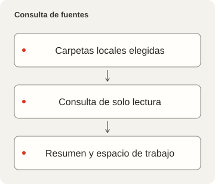
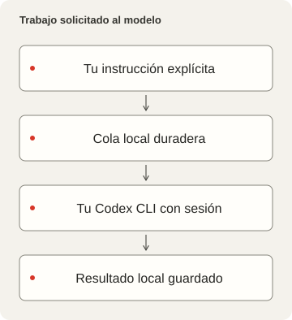

# LocalDesk

<p></p>

[English](README.md) · [简体中文](README.zh-CN.md) · [繁體中文](README.zh-TW.md) · [日本語](README.ja.md) · [한국어](README.ko.md) · [Español](README.es.md)

Un espacio local para configuración, scripts, skills, estado de proyectos y conversaciones persistentes con Codex CLI. Examina fuentes, cambios Git y hechos de ejecución, y mantiene cada conversación ligada a su propio directorio de trabajo.

## Producto y alcance del código

LocalDesk 0.2.1 es un espacio local independiente bajo licencia MIT. Usa sus propios datos, servicio y preferencias del navegador. Consulta [LICENSE](LICENSE), [NOTICE.md](NOTICE.md) y el [límite de privacidad](docs/PRIVACY-AUDIT.md).





## Empezar sin datos personales

Requiere Deno2.9+, Node22.12+, pnpm11.25 compatible con el lockfile, Git y Process Compose. macOS es el host verificado; otros sistemas no tienen aceptación física. Codex CLI es opcional para explorar. La interfaz admite inglés y chino simplificado／tradicional, temas claro／oscuro／del sistema y System／Pixel guardado. Este README no añade español a la interfaz.

```sh
pnpm --dir frontend install --frozen-lockfile
deno task setup
pnpm --dir frontend build
deno task start
```

Los puertos predeterminados son10000／15000. Si están ocupados, falla sin detener otro proceso ni elegir otro puerto. Cambia con `deno task setup --frontend-port 10100 --backend-port 15100`; en un entorno administrado usa la pareja registrada. Abre localhost en el puerto elegido y detén el propietario manual con Ctrl+C. Setup solo crea workspace／projects vacíos propios. Para fuentes existentes usa `--workspace /path/to/configuration --projects /path/to/projects` con rutas físicas.

## Elegir la ejecución del modelo

Inicia sesión con tu Codex CLI; LocalDesk no copia credenciales. `deno task doctor --models` muestra el catálogo local y niveles admitidos, sin pedir una respuesta al modelo. Selecciona uno disponible con `deno task setup --model MODEL_ID --effort EFFORT` y reinicia tras cambiar configuración. No hay modelo inicial: explorar funciona y enviar queda deshabilitado. Los modelos incompatibles fallan de forma visible.

Enviar ejecuta trabajo real y puede transmitir instrucciones／contexto al proveedor con coste. Modelo, razonamiento y Fast quedan guardados antes de aceptar. Sandbox usa workspace-write con escalada denegada; review opta explícitamente por `--approve-for-me` del CLI. No evita el sandbox ni la confianza en hooks. Elegir una carpeta no constituye aislamiento del sistema operativo.

La cola persiste antes de confirmar, deduplica UUID y limita cantidad, salida y tiempo con ejecución serial. El trabajo pendiente continúa al iniciar el servicio; una ejecución interrumpida requiere reanudación explícita. Detener no revierte cambios hechos. Conversaciones, resultados y borradores sobreviven a recargas. Archivar necesita un CLI compatible.

## Datos y conexiones

`<data>` usa Application Support/LocalDesk en macOS, XDG en Linux y Local AppData en Windows. `LOCALDESK_DATA` elige otro perfil; valores relativos parten del checkout. Contiene ajustes, `skills.local.json`, capacidad, trabajos, chats, SQLite, registros de skills y fuentes vacías iniciales. `LOCALDESK_CONFIG` cambia solo el archivo de ajustes. Cambiar perfil no migra datos. Local conserva únicamente compilación, definiciones operativas y logs. Usa el mismo perfil en el CLI y el servicio instalado.

Workspace sources／Projects and runtime en Settings detienen lecturas y nuevos trabajos al desconectar, conservando el historial. Termina o detén lo pendiente／activo en Activity antes. Ocultar módulos no detiene descubrimiento; otras rutas configuradas o comandos externos aún pueden acceder a archivos. Cambiar rutas requiere reiniciar. `/?view=skills` permite nombres, descripciones, categorías y vista previa de renombres con referencias. Escribir requiere Apply explícito, hashes, bloqueos y diario de recuperación; metadatos de destinos enlazados son de solo lectura. Consulta [configuración](docs/CONFIGURATION.md) y [contrato de skills](docs/skills.md).

## Red y verificación

El shell escucha en LAN, pero las API son solo locales salvo que se active shareCatalogOnLan. Solo comparte la lista de proyectos, rutas y estado Git en modo lectura; fuentes, modelos, trabajos, chats y cambios siguen locales. El acceso remoto usa `/workbench`. Valida Host／Origin y capacidad sin confiar en Authorization externo. No lo expongas tras un proxy que haga pasar clientes remotos por locales.

Process Compose posee ambos procesos HTTP. `deno task service --dry-run` solo valida y guarda definiciones en Local/runtime. Instalar es otra acción y rechaza puertos ocupados, etiquetas cargadas y plists conflictivos. Conserva el ejecutable lógico de PATH. Sin runtimeRegistry configurado, otros estados son desconocidos. La SQLite de exploración guarda la última instantánea, no una auditoría de todas las exploraciones.

```sh
deno task check
deno lint backend scripts tests
deno task test
deno task audit
```

Las pruebas usan un CLI sintético y carpetas temporales, sin modelos pagados. Source check／export／verificación de archivo excluyen historial privado, ajustes y datos. Compilar no demuestra modelos reales, otros sistemas, dispositivos, reinicio o rendimiento. Consulta [DEPENDENCIES.md](DEPENDENCIES.md) y [docs/RELEASE.md](docs/RELEASE.md). Fuentes y componentes conservan sus licencias.
