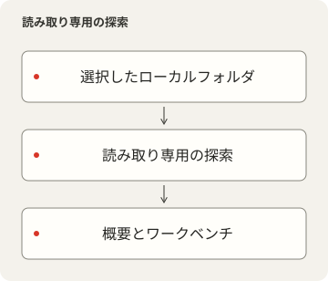
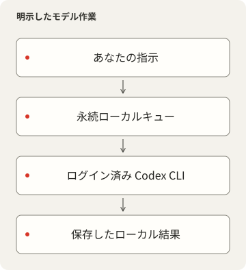

# LocalDesk

<p></p>

[English](README.md) · [简体中文](README.zh-CN.md) · [繁體中文](README.zh-TW.md) · [日本語](README.ja.md) · [한국어](README.ko.md) · [Español](README.es.md)

設定、スクリプト、スキル、プロジェクト状態、永続 Codex CLI 会話のためのローカルワークスペースです。ソースと Git／実行状態を調べ、各会話を固有の作業ディレクトリへ結び付けます。

## 製品とソースの境界

LocalDesk 0.2.1 は MIT ライセンスの独立したローカルワークスペースです。データ、サービス、ブラウザ設定を別に管理します。[LICENSE](LICENSE)、[NOTICE.md](NOTICE.md)、[プライバシーの範囲](docs/PRIVACY-AUDIT.md)を参照してください。





## 個人データなしで始める

Deno2.9以上、Node22.12以上、固定ロックと互換の pnpm11.25、Git、Process Compose が必要です。検証済みホストは macOS で、他 OS の実機受入を意味しません。閲覧に Codex CLI は不要です。UI は英語・簡体字・繁体字、明／暗／システム外観、保存される System／Pixel 書体です。日本語 README は日本語 UI の追加ではありません。

```sh
pnpm --dir frontend install --frozen-lockfile
deno task setup
pnpm --dir frontend build
deno task start
```

既定のフロントエンド10000／API15000が使用中なら失敗し、他プロセスを停止したり別ポートへ切り替えたりしません。変更は `deno task setup --frontend-port 10100 --backend-port 15100`、管理環境では登録済みペアを使います。localhost の設定ポートを開き、手動 Process Compose は Ctrl+C で停止します。setup は製品専用の空 workspace／projects だけを作成し、既存ファイルをコピーしません。既存ソースは `--workspace /path/to/configuration --projects /path/to/projects` で明示し、物理パスを選んでください。

## モデル実行を選ぶ

自分の Codex CLI でログインします。資格情報をコピーしません。`deno task doctor --models` はローカルのモデル／推論レベル一覧で、モデル応答を要求しません。`deno task setup --model MODEL_ID --effort EFFORT` で利用可能なモデルを選び、設定変更後は再起動します。モデルは既定で未選択、閲覧は可能でも送信は無効です。未対応モデルは明示的に失敗します。

送信は実際の作業とプロバイダへの指示／コンテキスト送信を伴い、料金が生じ得ます。モデル・推論・Fast は受理前に保存します。既定 sandbox は workspace-write／昇格拒否、review は CLI の `--approve-for-me` へ明示的に参加します。サンドボックスや信頼設定を迂回しません。作業フォルダ選択だけでは OS の隔離になりません。

キューは受理前に永続化し、UUID で重複を防ぎ、直列実行・待機数・出力・時間を制限します。待機作業はサービス起動で再開し、中断した実行は明示的再開が必要です。停止は既に行った変更を戻しません。会話／結果／ブラウザ下書きは再読込後も残ります。会話アーカイブは互換 CLI が必要です。

## データとソース接続

`<data>` の既定は macOS の `~/Library/Application Support/LocalDesk`、Linux の XDG、Windows の Local AppData です。`LOCALDESK_DATA` で別プロファイルを選び、相対値は checkout 基準です。設定、`skills.local.json`、能力トークン、ジョブ、会話、SQLite、スキル記録、空の既定ソースをここに置きます。`LOCALDESK_CONFIG` は設定ファイルだけを変更します。プロファイル変更は自動移行しません。Local にはビルド／運用定義とログだけを残します。通常 CLI とインストール済みサービスで同じプロファイルを使ってください。

Settings の Workspace sources／Projects and runtime は読取と新規作業を即時停止し、履歴を保持します。切断前に Activity の待機／実行作業を完了または停止してください。表示スイッチだけでは探索を停止しません。他の設定済みパスや外部コマンドはファイルにアクセスできます。パス変更は再起動が必要です。スキル管理 `/?view=skills` は名称・説明・分類・参照付き改名プレビューを持ち、書込は明示的 Apply とハッシュ／ロック／復旧記録で保護します。リンク先メタデータは読取専用です。[設定](docs/CONFIGURATION.md)、[スキル契約](docs/skills.md)に詳細があります。

## ネットワークと検証

シェルは LAN にバインドしますがデータ API はローカル peer 専用です。shareCatalogOnLan を明示した場合だけカタログ／プロジェクト情報を読取共有し、パスや Git 情報も含みます。ジョブ・会話・変更操作は共有しません。Host／Origin と能力を検証し、外部 Authorization を信用しません。遠隔クライアントがローカルに見える reverse proxy へ公開しないでください。

Process Compose が二つの HTTP 子プロセスを所有します。`deno task service --dry-run` は Local/runtime に定義を検証保存するだけです。インストールは別操作で、使用中ポート、読込済みラベル、競合 plist を拒否します。安定した PATH ランチャを記録します。プロジェクト実行観察は runtimeRegistry を明示しない限り不明です。SQLite のプロジェクト探索は最新キャッシュであり、全走査の監査履歴ではありません。

```sh
deno task check
deno lint backend scripts tests
deno task test
deno task audit
```

テストは合成 CLI と一時フォルダを使い、有料モデルを呼びません。公開前に Source check／export／アーカイブ検証を行い、私有履歴・設定・データを除外します。ビルドは実モデル、他 OS、機器、再起動、性能の証明ではありません。依存は [DEPENDENCIES.md](DEPENDENCIES.md)、公開手順は [docs/RELEASE.md](docs/RELEASE.md) を参照してください。フォントと部品の原ライセンスを保持します。
