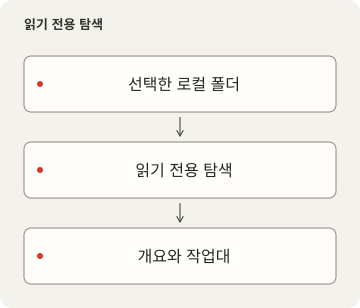
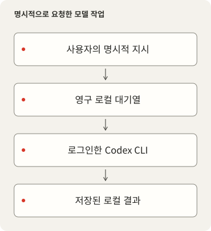

# LocalDesk

<p></p>

[English](README.md) · [简体中文](README.zh-CN.md) · [繁體中文](README.zh-TW.md) · [日本語](README.ja.md) · [한국어](README.ko.md) · [Español](README.es.md)

설정, 스크립트, 스킬, 프로젝트 상태와 영구 Codex CLI 대화를 위한 로컬 작업 공간입니다. 소스와 Git／실행 상태를 살펴보고 각 대화를 고유한 작업 디렉터리에 연결합니다.

## 제품과 소스의 범위

LocalDesk 0.2.1은 MIT 라이선스의 독립 로컬 작업 공간입니다. 데이터, 서비스, 브라우저 설정을 별도로 관리합니다. [LICENSE](LICENSE), [NOTICE.md](NOTICE.md), [개인정보 경계](docs/PRIVACY-AUDIT.md)를 확인하세요.





## 개인 데이터 없이 시작

Deno2.9 이상, Node22.12 이상, 고정 잠금과 호환되는 pnpm11.25, Git, Process Compose가 필요합니다. 검증된 호스트는 macOS이며 다른 OS의 실제 수용 검증은 없습니다. 탐색에는 Codex CLI가 필요하지 않습니다. UI는 영어／간체／번체, 밝게／어둡게／시스템 테마와 저장되는 System／Pixel 글꼴입니다. 한국어 README는 한국어 UI 추가가 아닙니다.

```sh
pnpm --dir frontend install --frozen-lockfile
deno task setup
pnpm --dir frontend build
deno task start
```

기본 프런트엔드10000／API15000이 사용 중이면 실패하며 다른 프로세스를 멈추거나 포트를 바꾸지 않습니다. 변경은 `deno task setup --frontend-port 10100 --backend-port 15100`을 사용하고 관리 환경에서는 등록된 쌍을 따릅니다. localhost의 설정 포트를 열며 수동 Process Compose는 Ctrl+C로 멈춥니다. setup은 제품 전용 빈 workspace／projects만 만들고 기존 파일을 복사하지 않습니다. 기존 소스는 `--workspace /path/to/configuration --projects /path/to/projects`로 명시하고 실제 물리 경로를 선택하세요.

## 모델 실행 선택

자기 Codex CLI로 로그인하며 자격 증명을 복사하지 않습니다. `deno task doctor --models`는 로컬 모델／추론 수준 목록이고 모델 응답을 요청하지 않습니다. `deno task setup --model MODEL_ID --effort EFFORT`로 사용 가능한 모델을 고르고 설정 뒤 재시작합니다. 기본 모델은 없으며 탐색은 가능하지만 전송은 꺼져 있습니다. 미지원 모델은 명확히 실패합니다.

전송하면 실제 작업과 제공자에 대한 지시／문맥 전송이 발생하며 비용이 들 수 있습니다. 모델, 추론, Fast를 접수 전에 저장합니다. 기본 sandbox는 workspace-write／권한 상승 거부이며 review는 CLI의 `--approve-for-me`에 명시적으로 참여합니다. 격리나 신뢰 설정을 우회하지 않습니다. 작업 폴더 선택만으로 OS 격리가 되지는 않습니다.

접수 전에 대기열을 저장하고 UUID로 중복을 방지하며 직렬 실행／대기 수／출력／시간을 제한합니다. 대기 작업은 서비스 시작 시 이어지고 중단된 실행은 명시적으로 재개해야 합니다. 중지는 이미 한 변경을 취소하지 않습니다. 대화／결과／브라우저 초안은 다시 불러와도 유지합니다. 대화 보관은 호환 CLI가 필요합니다.

## 데이터와 소스 연결

`<data>` 기본값은 macOS `~/Library/Application Support/LocalDesk`, Linux XDG, Windows Local AppData입니다. `LOCALDESK_DATA`로 다른 프로필을 선택하며 상대값은 checkout 기준입니다. 설정, `skills.local.json`, 능력 토큰, 작업, 대화, SQLite, 스킬 기록과 빈 기본 소스를 여기에 둡니다. `LOCALDESK_CONFIG`는 설정 파일만 바꿉니다. 프로필 변경이 기존 데이터를 이동하지는 않습니다. Local에는 빌드／운영 정의와 로그만 남습니다. 일반 CLI와 설치된 서비스에 같은 프로필을 사용하세요.

Settings의 Workspace sources／Projects and runtime 연결은 읽기와 새 작업을 즉시 멈추고 기록을 보존합니다. 끊기 전에 Activity에서 대기／실행 작업을 마치거나 멈추세요. 표시 스위치만으로 탐색이 중단되지는 않습니다. 다른 설정 경로나 외부 명령은 파일에 계속 접근할 수 있습니다. 경로 변경은 재시작이 필요합니다. `/?view=skills`는 이름／설명／분류와 참조를 포함한 이름 변경 미리보기를 제공하며 쓰기는 명시적 Apply, 해시, 잠금, 복구 기록으로 보호합니다. 링크 대상 메타데이터는 읽기 전용입니다. [설정](docs/CONFIGURATION.md), [스킬 계약](docs/skills.md)을 확인하세요.

## 네트워크와 검증

셸은 LAN에 바인딩하지만 데이터 API는 로컬 peer 전용입니다. shareCatalogOnLan을 명시한 경우에만 경로／Git 정보를 포함한 카탈로그와 프로젝트를 읽기 공유합니다. 작업／대화／변경은 공유하지 않습니다. Host／Origin과 능력을 확인하고 외부 Authorization을 신뢰하지 않습니다. 원격 클라이언트가 로컬처럼 보이는 reverse proxy에 노출하지 마세요.

Process Compose가 두 HTTP 프로세스를 소유합니다. `deno task service --dry-run`은 Local/runtime에 정의만 검사 저장합니다. 설치는 별도이며 사용 중 포트／로드된 라벨／충돌 plist를 거부합니다. 안정적인 PATH 실행기를 기록합니다. runtimeRegistry를 명시하지 않으면 다른 프로젝트 실행 상태는 알 수 없습니다. 프로젝트 SQLite 탐색은 최신 캐시이며 모든 탐색의 감사 기록이 아닙니다.

```sh
deno task check
deno lint backend scripts tests
deno task test
deno task audit
```

테스트는 합성 CLI와 임시 폴더를 쓰며 유료 모델을 호출하지 않습니다. 공개 전 source check／export／아카이브 검증으로 개인 이력／설정／데이터를 제외합니다. 빌드는 실제 모델, 다른 OS, 기기, 재부팅, 성능을 증명하지 않습니다. [DEPENDENCIES.md](DEPENDENCIES.md), [docs/RELEASE.md](docs/RELEASE.md)를 확인하세요. 글꼴과 구성 요소는 원래 라이선스를 유지합니다.
