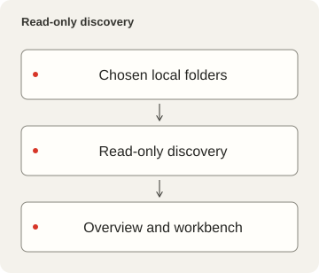
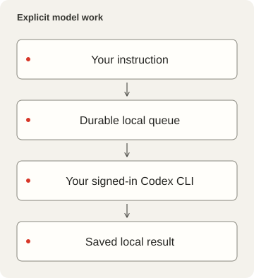

# LocalDesk

<p></p>

[English](README.md) · [简体中文](README.zh-CN.md) · [繁體中文](README.zh-TW.md) · [日本語](README.ja.md) · [한국어](README.ko.md) · [Español](README.es.md)

A local workspace for configuration, scripts, skills, project status and durable
Codex CLI conversations. Browse sources, inspect Git changes and runtime facts,
and keep each conversation tied to its own working directory.

## Product and source boundary

LocalDesk 0.2.1 is an independent local workspace under the [MIT License](LICENSE).
It uses its own data directory, service and browser preferences. Third-party
materials retain their own terms; see [notices](NOTICE.md) and the
[source boundary](docs/PRIVACY-AUDIT.md).

Source connections in Settings apply immediately and survive restart. Disconnect
Workspace sources to stop catalog/skill access, or Projects and runtime to stop
project discovery. New work for a disconnected source is disabled; saved history
is retained. Finish or stop queued/running work in Activity before
disconnecting. Module switches control visibility only. Other configured paths
or external commands can still access files. Path changes require a restart. See the
[connection contract](docs/CONFIGURATION.md#connect-and-disconnect-private-integrations).





## Start without personal data

Required: Deno 2.9 or later, Node.js 22.12 or later, pnpm compatible with the
committed lockfile, Git, and Process Compose. The frontend package manifest pins
the package-manager version; do not install the same UI dependencies with Deno,
npm or yarn. Codex CLI is optional for browsing. macOS is the currently verified
host; another OS is not a verified target merely because paths are portable.

From this directory:

```sh
pnpm --dir frontend install --frozen-lockfile
deno task setup
pnpm --dir frontend build
deno task start
```

The portable defaults use frontend `10000` and API `15000`. If those ports are
occupied, start fails without taking over the listener or selecting another
port. Choose explicit unused ports with
`deno task setup --frontend-port 10100
--backend-port 15100`. In a managed
workspace, use its registered pair instead.

Open the configured frontend on localhost. `Ctrl+C` stops the manually started
Process Compose owner and its children. The first setup creates only an empty
`<data>/workspace` and `<data>/projects`, not a copy of anyone's existing files.
Nothing is scanned outside those folders until you select other sources.

To use existing folders, run:

```sh
deno task setup --workspace /path/to/configuration --projects /path/to/projects
```

These folders must already exist. Discovery reads names, Git metadata and source
statistics; it does not install or execute discovered items. Built-in plugin
manifests look for `Brewfile`, `config`, `scripts`, `skills`, `services` and
`tools` under the selected workspace. Edit `plugins/*.json` to match your own
layout; absent sources are reported rather than silently replaced.

## Configure model execution deliberately

Sign in through your own Codex CLI. LocalDesk never copies login credentials.
`deno task doctor --models` lists the local CLI catalog's model IDs and
supported efforts. Select a model available to that account:

```sh
deno task setup --model MODEL_ID --effort EFFORT
```

Restart the LocalDesk process after changing backend configuration. No model is
selected by default; browsing remains available and sending is disabled until a
valid preset and CLI are available. Missing or unsupported models fail visibly.
The composer exposes the configured presets, supported reasoning levels and Fast
setting. These choices are captured before queue acceptance.

Sending an instruction executes real work and can send the selected prompt and
working context to the account's model provider. Default `approvalMode` is
`sandbox`: `workspace-write` with escalation denied in the noninteractive
runner. `review` explicitly opts into the installed CLI's `--approve-for-me`
automatic review. Neither mode bypasses the sandbox or hook trust. A working
folder selection is not an operating-system sandbox by itself.

The queue persists requests before accepting them, serializes execution, bounds
pending work and captured output, and deduplicates request UUIDs. Interrupted
running work requires an explicit resume; queued work resumes at service start.
Stop does not undo changes already made. Chats, results and unsent browser
drafts survive reloads. Chat archive/restore uses the installed CLI's session
commands; unsupported CLI versions produce an explicit error.

## Configuration, privacy and service ownership

The product data directory (`<data>`) defaults to `~/Library/Application Support/LocalDesk` on macOS, XDG data storage on Linux and Local AppData on Windows. Only macOS is verified. `LOCALDESK_DATA` selects another profile directory; relative values resolve from the checkout. Private `settings.local.json`, `skills.local.json`, jobs, capability, SQLite and durable records live there. The default blank workspace/projects also live there. `LOCALDESK_CONFIG` can select a different settings file without moving the data profile. Build output and service definitions remain ignored under Local. Changing a profile path does not migrate existing data.

[Configuration reference](docs/CONFIGURATION.md) documents every setting, path
resolution, limits and precedence. `config/settings.json` contains portable
defaults; private `<data>/settings.local.json` holds personal overrides.
`LOCALDESK_CONFIG` selects a different override instead of that local file.
Secrets, jobs, logs and SQLite records belong outside the tracked source.

The shell binds LAN by default, but **all data APIs are local-peer-only** unless
`shareCatalogOnLan` is explicitly enabled. Sharing exposes only the read-only
project list, including paths and Git status; source inventories, model settings,
jobs, chats and mutations remain local. Remote visitors open `/workbench`.
Unknown Host and foreign Origin requests are rejected;
incoming Authorization headers are not trusted by the frontend. Do not expose
this service through a reverse proxy that makes remote clients look local.

The self-contained `process-compose.yaml` supervises both HTTP processes with
restart and shutdown handling. There are no HTTP readiness/liveness probes.
`deno task service --dry-run` prepares and validates a macOS login service under
ignored `Local/runtime`. Installation is an explicit separate command; see
`deno task service --help`. It must not replace a loaded service or seize an
occupied port. Runtime observations of other projects are optional and require
an explicitly configured `runtimeRegistry`; without it their runtime is unknown.

Language, theme, System/Pixel typography and start-page preferences persist in
this product's own browser storage. System mode uses proportional UI/prose and
monospace technical values. The optional bundled pixel font retains its full
third-party notices.

## Verify and continue

```sh
deno task check
deno lint backend scripts tests
deno task test
deno task audit
pnpm --dir frontend build
```

The HTTP/CLI tests use temporary folders and a synthetic CLI, not an account or
a paid model request. Privacy checks are bounded source checks, not a guarantee
that every secret or vulnerability has been found.
[Dependency inventory](DEPENDENCIES.md), [privacy audit](docs/PRIVACY-AUDIT.md)
and [source review](docs/PRIVACY-AUDIT.md) distinguish what was verified from
pending release decisions.

## Skill management

Open `/?view=skills` to browse by purpose, edit skill names/descriptions, manage
categories and preview safe renames with references. Changes require explicit
Apply and are guarded by hashes, locks and recovery journals. Linked skills
retain read-only target metadata. See
[source, API and recovery contract](docs/skills.md).

## Source release notes

See [English](docs/RELEASE.md), [简体中文](docs/RELEASE.zh-CN.md) and
[繁體中文](docs/RELEASE.zh-TW.md) for payload, license, archive verification and
build scope.
