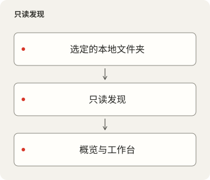
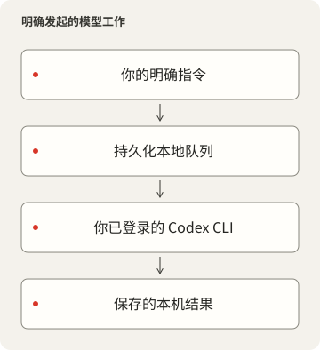

# LocalDesk

<p></p>

[English](README.md) · [简体中文](README.zh-CN.md) · [繁體中文](README.zh-TW.md) · [日本語](README.ja.md) · [한국어](README.ko.md) · [Español](README.es.md)

用于配置、脚本、技能、项目状态和持久化 Codex CLI 对话的本地工作空间。浏览来源、
查看 Git 改动与运行时事实，并让每段对话保持关联自己的工作目录。

## 产品与源码边界

LocalDesk 0.2.1 是采用 [MIT 许可](LICENSE) 的独立本机工作区，使用自己的数据目录、
服务与浏览器偏好设置。第三方素材保留各自条款，见[声明](NOTICE.md)与
[源码边界](docs/PRIVACY-AUDIT.md)。

设置中的“来源连接”立即生效并在重启后保留。“工作区来源”控制目录／技能读取；
“项目与运行状态”控制项目发现。拔除后停止读取和新任务，已存历史仍保留。
请先在活动页完成或停止排队／运行中的任务，再拔除。模块开关仅控制显示；
更改路径仍需重启。详见[连接契约](docs/CONFIGURATION.md#connect-and-disconnect-private-integrations)。





## 从空白数据开始

需要 Deno 2.9 或更新版本、Node.js 22.12 或更新版本、兼容已提交锁文件的 pnpm、Git
和 Process Compose。前端 package manifest 固定了包管理器版本；不要再用 Deno、npm
或 yarn 安装同一组 UI 依赖。浏览功能不要求 Codex CLI。macOS 是当前已验证的主机；
路径可移植不代表其他操作系统已经过验证。

在本目录运行：

```sh
pnpm --dir frontend install --frozen-lockfile
deno task setup
pnpm --dir frontend build
deno task start
```

可移植默认配置使用前端端口 `10000` 和 API 端口 `15000`。如果端口已被占用，启动会
失败，不会接管监听进程或自动选择其他端口。可通过
`deno task setup --frontend-port 10100 --backend-port 15100`
明确选择未使用的端口。 在受管理的工作空间中，应使用已登记的端口对。

通过 localhost 打开已配置的前端。`Ctrl+C` 会停止手动启动的 Process Compose
管理进程及其子进程。首次设置只创建空的 `<data>/workspace` 和 `<data>/projects`，
不会复制任何人的现有文件。在选择其他来源之前，不会扫描这两个文件夹之外的内容。

要使用现有文件夹，运行：

```sh
deno task setup --workspace /path/to/configuration --projects /path/to/projects
```

这些文件夹必须已经存在。发现功能读取名称、Git 元数据和源码统计，不会安装或执行
发现的项目。内置插件清单会在选定工作空间下查找 `Brewfile`、`config`、`scripts`、
`skills`、`services` 和 `tools`。修改 `plugins/*.json` 以匹配自己的目录布局；
缺少的来源会被报告，不会被静默替换。

## 明确配置模型执行

通过自己的 Codex CLI 登录。LocalDesk 从不复制登录凭证。
`deno task doctor --models` 会列出本地 CLI 目录中的模型 ID 和支持的推理强度。
选择该账号可用的模型：

```sh
deno task setup --model MODEL_ID --effort EFFORT
```

修改后端配置后，重启 LocalDesk 进程。默认不选择模型；浏览仍可使用，在有效预设与
CLI 就绪前，发送功能保持禁用。缺少或不支持的模型会明确报错。输入区提供已配置的
预设、支持的推理级别和 Fast 设置。这些选择会在请求入队前记录。

发送指令会执行真实工作，并可能把选定的提示词和工作上下文发送给该账号的模型
提供商。默认 `approvalMode` 为 `sandbox`：使用 `workspace-write`，并在非交互
执行器中禁止提权。`review` 明确启用已安装 CLI 的 `--approve-for-me` 自动审查。
两种模式均不会绕过沙箱或 hook 信任要求。选择工作文件夹本身并不是操作系统沙箱。

队列先持久化请求再确认接收，串行执行，限制待执行数量和捕获的输出，并按请求 UUID
去重。被中断的运行中工作需要明确继续；排队中的工作会在服务启动后继续。停止不会
撤销已经发生的改动。聊天、结果和未发送的浏览器草稿会在重新加载后保留。聊天归档/
恢复使用已安装 CLI 的会话命令；不支持的 CLI 版本会明确报错。

## 配置、隐私和服务归属

产品数据目录（`<data>`）在 macOS 默认是 `~/Library/Application Support/LocalDesk`；Linux 使用 XDG 数据目录，Windows 使用 Local AppData，当前仅验证 macOS。`LOCALDESK_DATA` 可选择另一份数据目录，相对值从源码目录解析。私人 `settings.local.json`、`skills.local.json`、任务、能力令牌、SQLite 与持久记录均放在其中；预设的空工作区／项目也在这里。`LOCALDESK_CONFIG` 可另选设置文件，不改变数据目录。Local 只保留建置输出和服务定义。更换数据目录不会自动搬移既有内容。

[配置参考](docs/CONFIGURATION.md) 说明所有设置、路径解析、限制和覆盖顺序。
`config/settings.json` 保存可移植默认值；忽略的 `<data>/settings.local.json`
保存个人覆盖配置。`LOCALDESK_CONFIG` 可指定另一个覆盖文件，替代该本地文件。
秘密信息、任务、日志和 SQLite 记录应放在受跟踪源码之外。

界面默认监听 LAN，但除非明确启用 `shareCatalogOnLan`，**所有数据 API 都仅供本机
客户端访问**。启用共享后，只读开放目录和项目元数据，包括路径与仓库信息。任务、
聊天和修改操作仍限本机。未知 Host 和外部 Origin 请求会被拒绝；前端不会信任传入的
Authorization 头。不要通过会让远端客户端看起来像本机的反向代理暴露此服务。

独立的 `process-compose.yaml` 监管两个 HTTP 进程，处理重启与关闭。不使用 HTTP
readiness/liveness probes。`deno task service --dry-run` 在忽略的
`Local/runtime` 下准备并验证 macOS 登录服务。安装是单独的明确命令；参见
`deno task service --help`。
它不得替换已加载的服务或抢占已用端口。其他项目的运行时观测是可选功能，需要明确
配置 `runtimeRegistry`；未配置时，其运行时状态为未知。

语言、主题、System/Pixel 字体和起始页偏好保存在本产品自己的浏览器存储中。System
模式为 UI/正文使用比例字体，为技术值使用等宽字体。可选的内置像素字体保留完整
第三方声明。

## 验证与继续开发

```sh
deno task check
deno lint backend scripts tests
deno task test
deno task audit
pnpm --dir frontend build
```

HTTP/CLI 测试使用临时文件夹和模拟 CLI，不使用真实账号或付费模型请求。隐私检查是
有范围限制的源码检查，不能保证发现所有秘密或漏洞。[依赖清单](DEPENDENCIES.md)、
[隐私审计](docs/PRIVACY-AUDIT.md) 和[源码审查](docs/PRIVACY-AUDIT.md)
区分已验证内容与待定的 发布决定。

## 源码交付说明

[简体中文](docs/RELEASE.zh-CN.md) · [繁體中文](docs/RELEASE.zh-TW.md) ·
[English](docs/RELEASE.md)：内容范围、许可、归档验证与构建限制。
