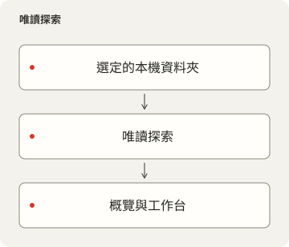
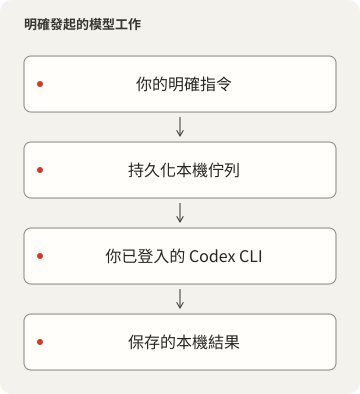

# LocalDesk

<p></p>

[English](README.md) · [简体中文](README.zh-CN.md) · [繁體中文](README.zh-TW.md) · [日本語](README.ja.md) · [한국어](README.ko.md) · [Español](README.es.md)

用於設定、指令碼、技能、專案狀態和持久化 Codex CLI
對話的本機工作空間。瀏覽來源、 查看 Git
變更與執行階段事實，並讓每段對話保持關聯自己的工作目錄。

## 產品與來源邊界

LocalDesk 0.2.1 是採用 [MIT 授權](LICENSE) 的獨立本機工作區，使用自己的資料目錄、
服務與瀏覽器偏好設定。第三方素材保留各自條款，見[聲明](NOTICE.md)與
[來源邊界](docs/PRIVACY-AUDIT.md)。

設定中的「來源連線」立即生效並於重啟後保留。「工作區來源」控制目錄／技能讀取；
「專案與執行狀態」控制專案探索。拔除後停止讀取與新工作，已存歷史仍保留。
請先在活動頁完成或停止排隊／執行中的工作，再拔除。模組開關僅控制顯示；
其他已設定路徑或外部指令仍可能存取檔案；變更路徑需重啟。詳見[連線契約](docs/CONFIGURATION.md#connect-and-disconnect-private-integrations)。





## 從空白資料開始

需要 Deno 2.9 或更新版本、Node.js 22.12 或更新版本、相容已提交鎖定檔的 pnpm、Git
和 Process Compose。前端 package manifest 固定了套件管理器版本；不要再用
Deno、npm 或 yarn 安裝同一組 UI 相依套件。瀏覽功能不要求 Codex CLI。macOS
是目前已驗證的主機； 路徑可攜不代表其他作業系統已經過驗證。

在本目錄執行：

```sh
pnpm --dir frontend install --frozen-lockfile
deno task setup
pnpm --dir frontend build
deno task start
```

可攜的預設設定使用前端連接埠 `10000` 和 API 連接埠 `15000`。如果連接埠已被占用，
啟動會失敗，不會接管監聽程序或自動選擇其他連接埠。可透過
`deno task setup --frontend-port 10100 --backend-port 15100`
明確選擇未使用的連接埠。 在受管理的工作空間中，應使用已登記的連接埠配對。

透過 localhost 開啟已設定的前端。`Ctrl+C` 會停止手動啟動的 Process Compose
管理程序及其子程序。首次設定只建立空的 `<data>/workspace` 和 `<data>/projects`，
不會複製任何人的現有檔案。在選擇其他來源之前，不會掃描這兩個資料夾之外的內容。

若要使用現有資料夾，執行：

```sh
deno task setup --workspace /path/to/configuration --projects /path/to/projects
```

這些資料夾必須已經存在。探索功能讀取名稱、Git
中繼資料和原始碼統計，不會安裝或執行
發現的項目。內建外掛清單會在選定工作空間下尋找 `Brewfile`、`config`、`scripts`、
`skills`、`services` 和 `tools`。修改 `plugins/*.json` 以符合自己的目錄配置；
缺少的來源會被回報，不會被無聲替換。

## 明確設定模型執行

透過自己的 Codex CLI 登入。LocalDesk 從不複製登入憑證。
`deno task doctor --models` 會列出本機 CLI 目錄中的模型 ID 和支援的推理強度。
選擇該帳號可用的模型：

```sh
deno task setup --model MODEL_ID --effort EFFORT
```

修改後端設定後，重新啟動 LocalDesk
程序。預設不選擇模型；瀏覽仍可使用，在有效預設與 CLI
就緒前，傳送功能保持停用。缺少或不支援的模型會明確報錯。輸入區提供已設定的
預設、支援的推理層級和 Fast 設定。這些選擇會在請求加入佇列前記錄。

傳送指令會執行真實工作，並可能把選定的提示詞和工作上下文傳送給該帳號的模型
提供者。預設 `approvalMode` 為 `sandbox`：使用 `workspace-write`，並在非互動
執行器中禁止提升權限。`review` 明確啟用已安裝 CLI 的 `--approve-for-me`
自動審查。 兩種模式均不會繞過沙箱或 hook
信任要求。選擇工作資料夾本身並不是作業系統沙箱。

佇列先持久化請求再確認接收，依序執行，限制待執行數量和擷取的輸出，並依請求 UUID
去除重複。被中斷的執行中工作需要明確繼續；排隊中的工作會在服務啟動後繼續。停止
不會復原已經發生的變更。聊天、結果和未傳送的瀏覽器草稿會在重新載入後保留。聊天
封存/還原使用已安裝 CLI 的工作階段命令；不支援的 CLI 版本會明確報錯。

## 設定、隱私和服務歸屬

產品資料目錄（`<data>`）在 macOS 預設是 `~/Library/Application Support/LocalDesk`；Linux 使用 XDG 資料目錄，Windows 使用 Local AppData，目前僅驗證 macOS。`LOCALDESK_DATA` 可選擇另一份資料目錄，相對值從原始碼目錄解析。私人 `settings.local.json`、`skills.local.json`、工作、能力權杖、SQLite 與持久紀錄均放在其中；預設的空工作區／專案也在這裡。`LOCALDESK_CONFIG` 可另選設定檔，不改變資料目錄。Local 只保留建置輸出與服務定義。更換資料目錄不會自動搬移既有內容。

[設定參考](docs/CONFIGURATION.md) 說明所有設定、路徑解析、限制和覆寫順序。
`config/settings.json` 儲存可攜的預設值；忽略的 `<data>/settings.local.json`
儲存個人覆寫設定。`LOCALDESK_CONFIG` 可指定另一個覆寫檔案，取代該本機檔案。
機密資訊、工作、記錄和 SQLite 資料應放在受追蹤原始碼之外。

介面預設監聽 LAN，但除非明確啟用 `shareCatalogOnLan`，**所有資料 API 都僅供本機
用戶端存取**。啟用分享後，唯讀開放目錄和專案中繼資料，包括路徑與儲存庫資訊。
工作、聊天和修改操作仍限本機。未知 Host 和外部 Origin 請求會被拒絕；前端不會
信任傳入的 Authorization 標頭。不要透過會讓遠端用戶端看起來像本機的反向代理
公開此服務。

獨立的 `process-compose.yaml` 監管兩個 HTTP 程序，處理重新啟動與關閉。不使用
HTTP readiness/liveness probes。`deno task service --dry-run` 在忽略的
`Local/runtime` 下準備並驗證 macOS 登入服務。安裝是單獨的明確命令；參見
`deno task service --help`。
它不得取代已載入的服務或搶占已用連接埠。其他專案的執行階段觀測是選用功能，需要
明確設定 `runtimeRegistry`；未設定時，其執行階段狀態為未知。

語言、主題、System/Pixel 字型和起始頁偏好儲存在本產品自己的瀏覽器儲存空間中。
System 模式為 UI/內文使用比例字型，為技術值使用等寬字型。選用的內建像素字型保留
完整第三方聲明。

## 驗證與繼續開發

```sh
deno task check
deno lint backend scripts tests
deno task test
deno task audit
pnpm --dir frontend build
```

HTTP/CLI 測試使用暫存資料夾和模擬 CLI，不使用真實帳號或付費模型請求。隱私檢查是
有範圍限制的原始碼檢查，不能保證發現所有機密或漏洞。[相依清單](DEPENDENCIES.md)、
[隱私稽核](docs/PRIVACY-AUDIT.md) 和[來源審查](docs/PRIVACY-AUDIT.md)
區分已驗證內容與待定的 發布決定。

## 來源交付說明

[繁體中文](docs/RELEASE.zh-TW.md) · [简体中文](docs/RELEASE.zh-CN.md) ·
[English](docs/RELEASE.md)：內容範圍、授權、封存驗證與建置限制。
